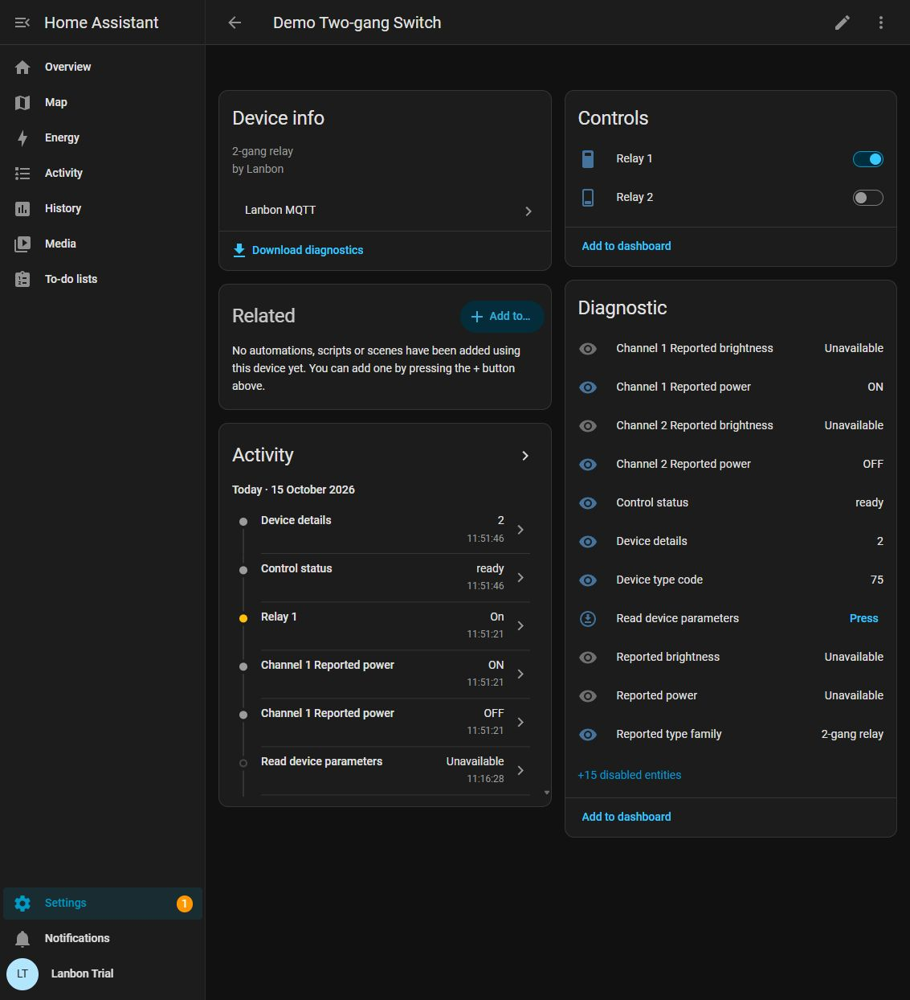

# Lanbon MQTT for Home Assistant

Local controls, reported state and mesh diagnostics for Lanbon devices running
the **stock, legacy Smart Living MQTT profile**. Set it up through normal Home
Assistant screens, using the MQTT broker you already have.

**First public release: `0.3.0-rc.4` — a release candidate.** Install through HACS
as a custom repository. Inclusion in the HACS default catalogue is a separate
process. This community project is not affiliated with Lanbon, Home Assistant
or HACS.

*Example from an isolated Home Assistant demonstration with synthetic devices.
Device names, addresses and readings are illustrative.*

## What it does

- Discovers mesh topic IDs with a passive 35-second scan, with manual entry for
  quiet networks.
- Provides dimmers and individual relay switches for qualified device types.
- Recovers reported output from a bounded root-cache query and keeps source and
  freshness visible.
- Exposes firmware, device type, raw inventory, timer parameters and optional
  root/child network diagnostics.
- Explains missing controls with an enabled **Control status** sensor.
- Preserves existing MQTT controls and automation references. An explicit
  option adds separate Lanbon controls alongside them.

It does not require Node-RED, another custom integration, a cloud account or
author-specific scripts. You do not enter broker credentials in Lanbon MQTT;
the native Home Assistant MQTT integration manages the connection and TLS.

## Before you install

You need **Home Assistant 2026.9.3 or newer**, HACS for the recommended install,
and a connected [Home Assistant MQTT integration](https://www.home-assistant.io/integrations/mqtt/).
Your Lanbon mesh must already send its native messages to that broker. An
external broker is supported if both Home Assistant and the Lanbon root can
reach it; the Mosquitto app is optional.

This integration does not provision the switch's Wi-Fi or broker settings,
replace firmware, or add MQTT support to incompatible devices. A device sold
under the Lanbon name is not automatically compatible.

| Reported type | Controls | Qualification |
|---|---|---|
| `0x4A` | One relay | Current supported inventory and a validated native channel route |
| `0x4B` | Two independent relays | Same; each channel needs its own route |
| `0x4C` | Three independent relays | Same; each channel needs its own route |
| `0x4D` | Dimmable light, 0–100% | Current supported inventory and selected legacy profile |
| Other or unknown types | Diagnostics only where understood | No actuator is guessed from a product name or raw byte |

See [compatibility and evidence](docs/compatibility.md) for tested environments
and physical commissioning limits. Root-cache state can be assumed and stale;
an MQTT report or a successful command is not proof of physical delivery.

## Install in HACS

1. Open **HACS → ⋮ → Custom repositories**.
2. Add `https://github.com/Dozi3/lanbon-mqtt` with type **Integration**.
3. Open **Lanbon MQTT**, choose **Download**, and select the published release.
   For a release candidate, enable **Show beta versions** if your HACS version
   offers that option, then choose the `rc` version explicitly.
4. Restart Home Assistant.
5. Open **Settings → Devices & services → Add integration → Lanbon MQTT**.

The [illustrated setup guide](SETUP.md) covers discovery, every setting and
optional network metadata. No YAML or JSON configuration is required.

## Use your devices

Open **Settings → Devices & services → Lanbon MQTT → Devices** and select a
device. Use **Dimmer** for a light or the individual relay controls for a switch.
Tap the dimmer entity to open its brightness slider.

If an existing integration already provides that device's controls, open
**Lanbon MQTT → Configure** and enable both **Enable supported light and switch
controls** and **Add Lanbon controls alongside existing controls**. This adds
Lanbon's controls without renaming or moving the old entities. Their device
pages remain separate.

## Documentation

| Guide | Contents |
|---|---|
| [Install and setup](SETUP.md) | HACS, MQTT prerequisite, native forms and screenshots |
| [Everyday use](docs/usage.md) | Controls, dashboards, diagnostics and freshness |
| [Troubleshooting and FAQ](docs/troubleshooting.md) | No controls, quiet discovery, unavailable entities and broker checks |
| [Updates, rollback and removal](docs/updates.md) | Backups, version changes and recovery |
| [Diagnostic catalogue](DIAGNOSTICS.md) | Exposed fields, raw values and interpretation limits |
| [Protocol contract](PROTOCOL.md) | Topics, binary layouts and command qualification |
| [Verification](TESTING.md) | Reproducible checks and evidence boundaries |
| [Changelog](CHANGELOG.md) | Release changes |

For help, use [Support](SUPPORT.md). For contributions, read
[Contributing](CONTRIBUTING.md). Report vulnerabilities privately through the
[security policy](SECURITY.md).

Licensed under the [MIT License](LICENSE).
