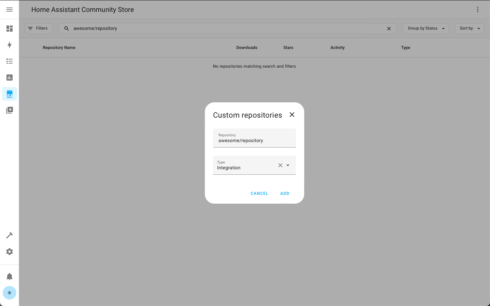
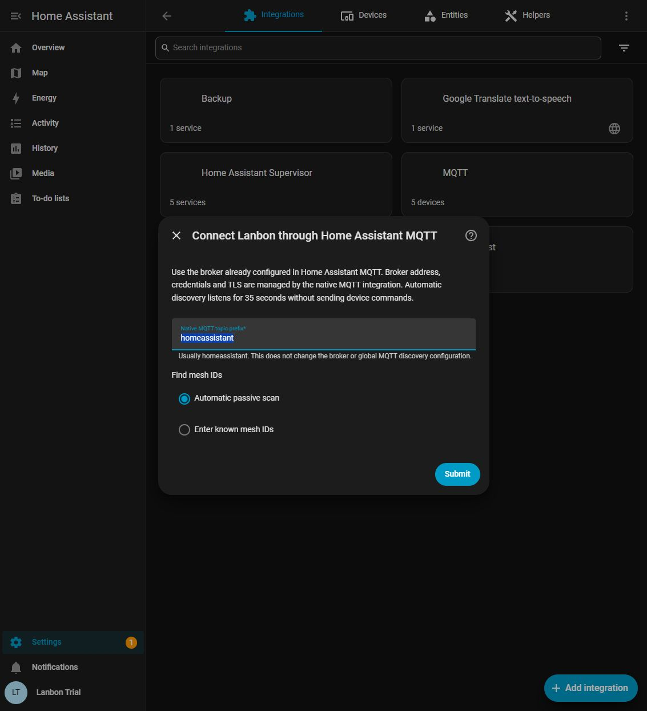
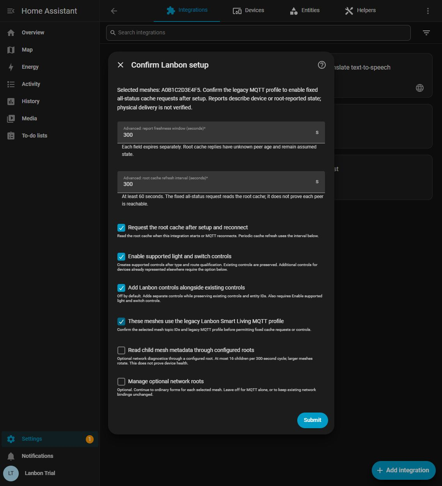
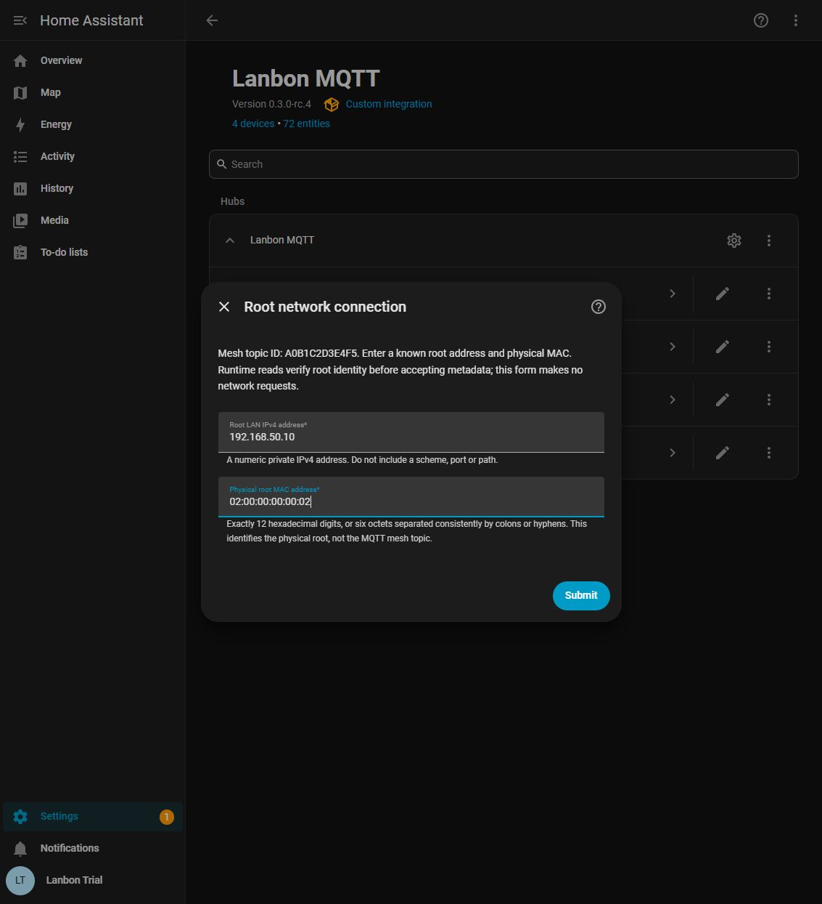

# Install and configure Lanbon MQTT

[Home](README.md) · [Use](docs/usage.md) · [Troubleshooting](docs/troubleshooting.md)
· [Updates and rollback](docs/updates.md)

Lanbon screenshots show an isolated Home Assistant demonstration with
synthetic devices. Example identities and values are not settings to copy
into your installation. The HACS dialog image is from its official
documentation, used under the MIT licence. Screens can differ between Home
Assistant and HACS versions.

## 1. Check prerequisites

- Home Assistant **2026.9.3 or newer**. The accepted native runtime was tested
  on Core 2026.10.1; newer versions still need their own regression checks.
- Devices using the supported **legacy Lanbon Smart Living MQTT profile**,
  already configured to publish to your broker.
- A connected **MQTT** integration in Home Assistant.
- [HACS installed and configured](https://www.hacs.xyz/docs/use/) for the
  recommended installation method.
- A current Home Assistant backup and its recovery key, where applicable.

The integration cannot configure the broker inside a wall switch. Follow your
device's supported setup procedure first. Do not expose an unauthenticated
broker to the Internet to make a switch reachable.

## 2. Install through HACS

1. Open **HACS** from the Home Assistant sidebar.
2. Select the top-right **⋮ → Custom repositories** menu.
3. Enter `https://github.com/Dozi3/lanbon-mqtt` and select **Integration** as the
   type. Select **Add**.
4. Find **Lanbon MQTT**, open it and select **Download**.
5. Select a published version. The first public release is `0.3.0-rc.4`, a
   prerelease. If it is hidden, enable **Show beta versions** in the repository
   menu if offered, then use the version selector in **Download/Redownload**.
6. Restart Home Assistant when prompted.

*Official HACS dialog example. Enter `https://github.com/Dozi3/lanbon-mqtt`
with type Integration. Custom-repository installation is independent of
inclusion in the default catalogue. [Image source and licence](THIRD-PARTY-NOTICES.md).*

These steps follow the official [HACS custom repository guide](https://www.hacs.xyz/docs/faq/custom_repositories/)
and [download/version selection guide](https://www.hacs.xyz/docs/use/repositories/dashboard/).

### Manual installation alternative

Download a tagged release from [Releases](https://github.com/Dozi3/lanbon-mqtt/releases).
Copy only its `custom_components/lanbon_mqtt` directory into your Home Assistant
configuration directory, so the final path is
`config/custom_components/lanbon_mqtt/manifest.json`. Avoid an extra nested
release directory. Restart Home Assistant, then continue below. Do not install
the repository's development environment into Home Assistant.

## 3. Connect Home Assistant MQTT

If MQTT is already connected, leave its connection settings in place.
Otherwise open **Settings → Devices & services → Add integration → MQTT** and
enter your broker details using the native MQTT screens. Configure credentials,
TLS certificates and certificate verification there.

Lanbon MQTT reuses this connection. It does not ask for another broker password.
An external broker is supported; you do not need the Mosquitto app on Home
Assistant OS. Both the devices and Home Assistant must be able to use the
appropriate broker topics and permissions. Consult the native
[MQTT documentation](https://www.home-assistant.io/integrations/mqtt/) for its
supported brokers and connection options.

## 4. Add Lanbon MQTT and select meshes

Open **Settings → Devices & services → Add integration → Lanbon MQTT**.

If MQTT is missing or disconnected, the prerequisite screen explains the
problem. Open the native MQTT integration to complete its setup or restore its
connection, return to Lanbon MQTT, then retry.

On **Connect Lanbon through Home Assistant MQTT**:

- **Native MQTT topic prefix**: normally `homeassistant`. Use your devices'
  actual prefix. Multiple literal levels such as `myhome/lighting` are allowed;
  MQTT wildcards are not. This field does not change HA's global MQTT settings.
- **Find mesh IDs**: choose **Automatic passive scan** or **Enter known mesh
  IDs**.

*The scan listens for 35 seconds and sends no device command.*

For automatic discovery, select the meshes belonging to your installation.
Current reports rank ahead of retained hints. Retained configuration can help
identify a mesh but cannot prove that it is reachable now.

For manual entry, use the **Mesh topic IDs** field. Enter 12 hexadecimal digits
per ID, one per line or separated by commas. A mesh topic ID is not necessarily
the root device's physical MAC. Find it in your existing native MQTT topic
structure or device configuration; do not substitute the first MAC address you
see. One Lanbon entry supports up to **16 meshes** on HA's configured broker.

## 5. Confirm settings

Confirm that the chosen meshes use the supported legacy profile. The completed
setup permits the documented fixed root-cache requests and qualified controls;
the discovery scan itself is passive.

| Setting | Default | Meaning |
|---|---|---|
| **These meshes use the legacy Lanbon Smart Living MQTT profile** | Requires your confirmation | Confirms the protocol and selected meshes before cache requests or controls are permitted |
| **Enable supported light and switch controls** | On | Creates controls only after type, membership and route qualification |
| **Add Lanbon controls alongside existing controls** | Off | Adds separate Lanbon controls where other integrations already provide them; old entities and automation references remain unchanged |
| **Request the root cache after setup and reconnect** | On | Requests the root's reported snapshot after startup or MQTT reconnection |
| **Advanced: report freshness window (seconds)** | 300 | Per-field freshness lease; accepted range 30–86400 seconds |
| **Advanced: root cache refresh interval (seconds)** | 300 | Periodic fixed all-status cache request; accepted range 60–86400 seconds |
| **Manage optional network roots** | Off | Opens ordinary forms to add, edit or remove optional root metadata connections |
| **Read child mesh metadata through configured roots** | Off | Enables bounded child metadata reads through an explicitly configured root |

The freshness window does not make a cached report live RF evidence. Leave the
advanced defaults unless you understand the tradeoff between refresh traffic
and the age of displayed reports.

### Keep your existing controls

If you already have working MQTT or other controls, leave them installed. To
also show switches and dimmers on **Lanbon** device pages, enable both control
options above. Their stable identities use physical peer/channel/function.
Existing entity IDs, names, history, helpers and automations are preserved.

Lanbon and MQTT device pages remain separate. This is an additional control
surface, not a device/entity migration. Avoid creating two automations that
fight over the same physical output.

## 6. Optional network metadata

Skip this section for MQTT-only operation. It is not needed for supported MQTT
controls or normal state reports.

Choose **Manage optional network roots**, then **Add or edit a root**. Select a
configured mesh topic ID and enter:

- **Root LAN IPv4 address**: a numeric private RFC1918 IPv4 address, with no
  scheme, port or path.
- **Physical root MAC address**: the actual forwarding root's unicast MAC,
  written as 12 hex digits or six consistently colon/hyphen separated octets.

*These optional values must describe your own root. The mesh topic ID and
physical root MAC can differ.*

Each root address and physical MAC must be unique. This optional transport uses
the qualified local metadata API on **HTTP port 80**. DNS names, IPv6, HTTPS,
alternate ports and redirects are not supported. No credentials are requested
for this metadata API. Identity checks must succeed before metadata is used.

Child reads remain optional and go through the configured root, with at most
16 children per 300-second cycle; larger meshes rotate. These reads expose
mesh/link/framework metadata, not verified physical state or device health.

Choose **Save and finish** to apply the draft. Cancelling does not apply it.

## 7. Verify the first device

1. Open **Lanbon MQTT → Devices** and select a device with a supported type.
2. Read its **Control status**. `ready` means the control prerequisites are met;
   it is not a physical-delivery guarantee.
3. Check that reports arrive and that their source/freshness is appropriate.
4. Choose a safe light to test. Compare one on/off action and, for a dimmer, a
   brightness change with the physical output. Restore its previous state.
5. Add the working entity to your dashboard through Home Assistant's normal
   dashboard editor.

If controls are missing, first check the [Control status guide](docs/troubleshooting.md#control-status).
For everyday controls and parameter sensors, continue to [Using Lanbon MQTT](docs/usage.md).

## Change settings later

Open **Settings → Devices & services → Lanbon MQTT → Configure**. The normal
Options flow lets you change meshes, prefix, controls and optional root
bindings. Save the completed flow; the integration reloads with the new settings.
Removing a mesh with a saved network binding asks you to confirm removal of
that binding. Other drafts remain unapplied until you save.
