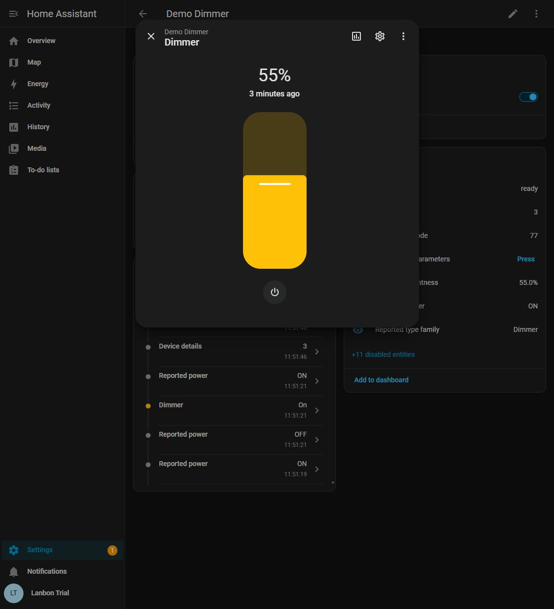

# Using Lanbon MQTT

[Home](../README.md) · [Setup](../SETUP.md) · [Troubleshooting](troubleshooting.md)

## Find the controls

Open **Settings → Devices & services → Lanbon MQTT → Devices** and select a
physical device. The device page groups the integration's controls and
diagnostics. MQTT may also have a separate page for the same physical switch;
existing device records are preserved.

*Isolated demonstration with synthetic devices and reports.*

- A qualified `0x4D` device has a **Dimmer** light. Use its toggle for on/off.
  Tap the entity to open the native light dialog and brightness slider.
- Qualified `0x4A`, `0x4B` and `0x4C` devices have one, two or three relay
  controls. Each gang needs an independently qualified native route.
- **Control status** explains whether controls are ready, intentionally
  suppressed, waiting for evidence or unsupported.

*The standard Home Assistant light dialog supplies brightness control. The
example value is synthetic.*

For controls alongside existing MQTT entities, enable both **Enable supported
light and switch controls** and **Add Lanbon controls alongside existing
controls** under **Lanbon MQTT → Configure**. Existing IDs and automation
references remain intact.

## Add a dashboard or automation

Use Home Assistant's dashboard editor to add the light or switch entity to a
card. Use those same entities with normal light/switch actions in automations.
There is no integration-specific control service or dashboard to install.

Use one intended control path in each automation. If you expose both an old
MQTT entity and a new Lanbon entity, they still operate the same physical load.
Enabling additional controls does not copy or migrate your automations.

## Understand reported state

The integration separates command intent from feedback. Sending a command does
not immediately invent a new state; accepted reports determine the display.
The brightness setting is tracked independently from power, so an OFF light
can retain a remembered brightness.

Reports can be direct native feedback, qualified synchronization data or a
root-cache snapshot. A root-cache reply has **unknown peer age** and stays
assumed. Retained replay is not fresh physical feedback. Each reported field
has its own freshness window; a field becoming unknown is different from the
MQTT connection being disconnected.

Inspect the entity's source, confidence and freshness attributes when timing
matters. A connected broker, `ready` control or recent message alone cannot
establish that a remote mesh peer or its attached lamp is physically healthy.

## Read device parameters

For supported, currently qualified devices, **Read device parameters** sends
four fixed read requests for timer-related settings. It does not create,
activate, edit or cancel a timer. Read the returned schedules in **Device
details** or the corresponding parameter sensors.

Timer values describe what was reported: a configured inactivity period is not
a remaining countdown, and a reported schedule does not prove it will execute.
The [diagnostic catalogue](../DIAGNOSTICS.md) explains these distinctions.

## Enable the diagnostics you need

Firmware, type, Device details and Control status are available by default.
Many separate raw or frequently changing diagnostic sensors are disabled by
default to limit entity and recorder load. To use one independently:

1. Open the device's entity list and include disabled entities.
2. Select the required sensor, open its settings and enable it.
3. Allow the next accepted report/diagnostic refresh to populate it.

The complete latest accepted metadata remains available in **Device details**;
you do not need to enable every raw sensor. Diagnostic updates are coalesced;
they do not create a full packet history.

Optional network metadata requires an explicit root binding in Configure. See
[setup](../SETUP.md#6-optional-network-metadata) before enabling it.
